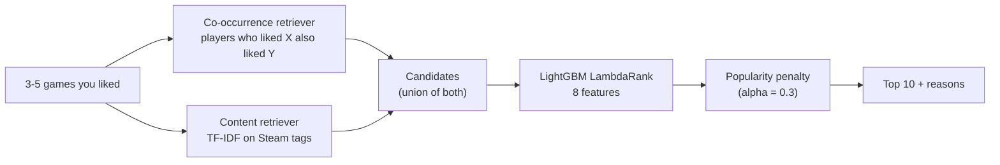

# Hybrid Steam Game Recommender

[](https://github.com/An1sh-R/Hybrid-Steam-Recommender-System/actions/workflows/ci.yml)

Pick 3 to 5 Steam games you enjoyed and get 10 recommendations, each with the reason it was picked:

- *"Players who liked Cyberpunk 2077 also liked this"*
- *"Because you liked The Witcher 3: shares Magic, Open World, Fantasy"*

**Live demo:** https://hybrid-steam-recommender-system-latest.onrender.com/
(free hosting: the first visit after a quiet spell takes about a minute while the server wakes up)

Built on 41 million user reviews from the Kaggle [Game Recommendations on Steam](https://www.kaggle.com/datasets/antonkozyriev/game-recommendations-on-steam) dataset (13.8M players, 50K games).

## How it works



1. **Two retrievers** propose candidates from the seed games:
   - **Item-item co-occurrence (collaborative):** cosine similarity between games, based on which games the same players liked. It's computed with sparse matrix products over each player's 100 most recent likes, keeping each game's 100 nearest neighbours (at least 5 shared players).
   - **Content:** TF-IDF on Steam community tags, with cosine similarity. It also works for new games nobody has reviewed yet. 1,244 games had no tags in the dataset, many of them very popular; tags for the real games among them were fetched from the SteamSpy API.
2. **A LightGBM LambdaRank ranker** reorders the union of candidates. Its 8 features:
   - each retriever's score and rank
   - the game's popularity, like share, price and age
3. **Re-ranking:** a popularity penalty (alpha = 0.3) pushes the list away from only the biggest hits.
4. **Explanations:** each pick is explained by whichever retriever ranked it higher, naming the seed game that led to it.

Below the top 10, the page also shows 5 picks straight from each retriever ("Similar games", "Players also liked"). The home page lists the 30 most-liked games, so you can pick seeds in a click.

## Results

**Evaluation setup:**
- **Time-based split**, so the models never see the future:
  - training data before 2022-02-16
  - validation from 2022-02-16 to 2022-08-13
  - test from 2022-08-13
- **The test** uses 50,000 sampled players. Each player's 3-5 most recent likes are the input, and the games they liked during the test period are the targets.
- **Tuning:** every choice was tuned on validation. The test set was used once, at the end.

| Test set (50K users) | Recall@10 | NDCG@10 | New-game Recall@10 | Coverage@10 | Head share@10 |
|---|---|---|---|---|---|
| Popularity baseline | 0.020 | 0.012 | 0.000 | 0.03% | 100% |
| Content only | 0.018 | 0.010 | 0.018 | 40.7% | 13% |
| Co-occurrence only | 0.067 | 0.039 | 0.000 | 16.4% | 71% |
| Ranker (no penalty) | **0.100** | **0.062** | 0.035 | 7.9% | 72% |
| **Final system** (ranker + penalty) | 0.098 | 0.057 | **0.052** | 10.3% | **58%** |

- **The final system is 4.8× the popularity baseline and 1.5× the best single retriever (co-occurrence) on Recall@10.**
- **The popularity penalty is a deliberate trade:** −8% NDCG for a much less popularity-heavy list. The share of picks from the top 1% of games falls from 72% to 58%, and recall on games released during the test period rises by half (0.035 → 0.052).
- **The budget was set in advance and was exceeded:** at most 5% NDCG loss, measured on validation (−4.4% there). On test the loss was larger (−7.9%), and that's reported as is, not re-tuned.
- **Pool recall:** 38% of the target games are among the candidates at all. That caps what any ranker could reach.

**Metric definitions:**
- **Recall@10:** the share of a player's future likes that appear in their 10 recommendations.
- **New-game recall:** the same, but only for games released after training.
- **Coverage:** the share of the catalog recommended to anyone.
- **Head share:** the share of picks that come from the 1% most popular games.

## MLOps

- **DVC pipeline:** 9 stages, re-run only when their inputs change (`dvc repro`), with data and models stored on [DagsHub](https://dagshub.com/anish.ray2006/Hybrid-Steam-Recommender-System).
  - stages: `prepare → split → cooccurrence / content → evaluate → ranker → rerank → final_eval`, plus `serve_build`, which refits on all data for the app
  - metrics are tracked as JSON, and `dvc metrics diff` compares runs
- **CI/CD with GitHub Actions:**
  - every pull request runs ruff, the 88 pytest tests (on tiny fake data), a Docker build, and a smoke test that calls `/health` and `/recommend` on the running container
  - a merge to `main` publishes that exact tested image to GitHub Container Registry (tagged with the commit) and triggers a Render deploy
- **Docker:**
  - the image holds the code and the ~51MB of serving files, nothing else
  - it runs as a non-root user and has a health check
  - it is tuned to fit Render's 512MB free tier. Measuring under a 512MB cap showed it was killed for running out of memory at startup. Loading only the needed columns, using 32-bit ids, and switching Arrow and glibc to allocators that return freed memory brought it to ~360MB.
- **Reproducible environment:** uv with a lockfile, and Python 3.12.

## Tech stack

Python, pandas, NumPy, SciPy (sparse matrices), scikit-learn (TF-IDF), LightGBM, FastAPI, plain HTML/CSS/JavaScript, DVC + DagsHub, Docker, GitHub Actions, Render, uv, pytest, ruff.

## Run it locally

You need [uv](https://docs.astral.sh/uv/) and DagsHub read access for the data.

```bash
git clone https://github.com/An1sh-R/Hybrid-Steam-Recommender-System.git
cd Hybrid-Steam-Recommender-System
uv sync

# Only the files the app needs (~51MB), not the full pipeline data:
uv run dvc pull data/serve data/content/neighbors.parquet models/ranker.txt

uv run uvicorn steam_rec.api:app
# open http://127.0.0.1:8000
```

**With Docker** (after the `dvc pull` above):

```bash
docker build -t steam-rec .
docker run --rm -p 8000:8000 steam-rec
```

**Re-running the whole pipeline:**
1. Download the Kaggle dataset into `data/raw/`.
2. Run `uv run dvc repro`. This takes tens of minutes and needs several GB of RAM.

**Tests:** `uv run pytest`. They use small fake data, so they need no download.

## API

| Method | Path | What it does |
|---|---|---|
| GET | `/` | Home page: the 30 most-liked games |
| GET | `/recommendations` | The recommendations page |
| GET | `/search?q=hollow` | Games whose title contains the text |
| GET | `/top?limit=30` | Most-liked games of all time |
| POST | `/recommend` | Body `{"app_ids": [3-5 ids]}` → top 10, plus 5 per retriever, each with a reason |
| GET | `/health` | Health check |

Interactive docs: `/docs`.

## Project layout

```
src/steam_rec/      pipeline stages (prepare, split, cooccurrence, content, ranker, rerank, ...),
                    the recommender, the FastAPI app, and the static web pages
tests/              pytest suite on tiny toy data
notebooks/          exploratory data analysis
dvc.yaml            the pipeline; dvc.lock pins every stage's inputs and outputs
metrics/            validation and test metrics (JSON)
Dockerfile          the serving image
.github/workflows/  CI/CD
```

## Limitations

- **The data ends in December 2022.** Newer games are unknown, and the most-liked list reflects that period.
- **DLC and some software can appear in recommendations.** The non-game filter only catches soundtracks and the like; widening it would change the evaluated system, so it's left as a known gap.
- **Explanations describe the retriever that ranked a game higher.** They're faithful to that signal, but they aren't a full account of the ranker's decision.
- **Free hosting** sleeps when idle and has 0.1 CPU, so a recommendation takes 1-2 seconds.

Game images and data from Steam. This project is not affiliated with Valve.
